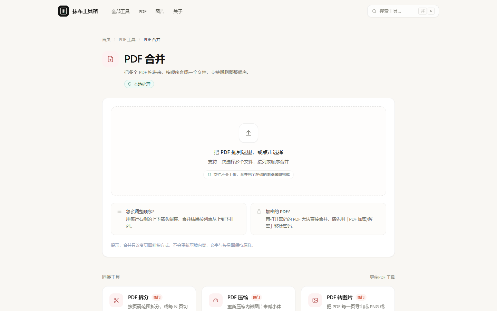

# 抹布工具箱

一个纯前端的免费在线小工具站：**41 个工具，文件不上传，全部在浏览器里处理**。

[](LICENSE)
[](https://github.com/kakshinji/mabu-toolbox/actions/workflows/deploy.yml)
[](tests/测试报告.md)

**在线使用**：https://kakshinji.github.io/mabu-toolbox/


- 纯静态站点，无后端、无数据库，部署到任意静态托管即可
- 每个工具一个独立路由，方便分享和被搜索到
- 免费、无广告、无需注册

## 快速开始

```bash
npm install
npm run dev      # 开发：http://localhost:5173
npm run build    # 构建到 dist/
npm run preview  # 本地预览构建产物
```

## 工具清单（41 个）



### PDF 工具（9）
| 工具 | 路由 | 说明 |
|---|---|---|
| PDF 合并 | `/tools/pdf-merge` | 多文件按顺序合并，可调整顺序 |
| PDF 拆分 | `/tools/pdf-split` | 按范围、每 N 页、每页单独拆分 |
| PDF 压缩 | `/tools/pdf-compress` | 渲染后重编码，适合扫描件 |
| PDF 转图片 | `/tools/pdf-to-image` | 导出 PNG/JPG，可选清晰度 |
| 图片转 PDF | `/tools/image-to-pdf` | 多图合成，可选 A4/Letter |
| PDF 旋转 | `/tools/pdf-rotate` | 整份或指定页旋转 |
| PDF 加水印 | `/tools/pdf-watermark` | 文字水印，可平铺 |
| PDF 加页码 | `/tools/pdf-page-number` | 自定义格式与位置 |
| PDF 加密/解密 | `/tools/pdf-protect` | AES-256 加密，或移除已知密码 |

### 图片工具（8）
图片格式转换（含 HEIC）、图片压缩、批量缩放、加文字水印、纯色去底、长图拼接、图片转 Base64、图片文字识别 OCR。

### 音视频（3）
音视频格式转换、视频转 GIF、视频截取。基于 ffmpeg.wasm，首次使用需下载约 30MB 引擎。

### 文本处理（5）
JSON 格式化/校验/转 CSV·YAML·XML、文本清洗、正则测试、Markdown 预览、命名风格转换。

### 编码加密（4）
Base64 编解码、URL 编解码、哈希计算（MD5/SHA 系列）、JWT 解析。

### 开发辅助（6）
二维码生成、二维码识别、时间戳转换、颜色工具、UUID 生成、Cron 解析。

### 格式转换（2）
Word 转 PDF（文字重排）、PDF 转文本。

### 生活计算（4）
单位换算、日期计算、贷款计算、BMI/热量估算。

## 目录结构

```
src/
  App.tsx               # 路由、首页、工具列表、关于页
  tools/registry.ts     # 工具元数据（名称/分类/关键词），新增工具先改这里
  tools/pages/          # 每个工具一个组件
  components/           # Dropzone、FileList、ResultPanel、Segmented 等通用 UI
  content/seo.ts        # 每个工具的 SEO 文案（介绍 / 功能点 / FAQ / 关键词）
  lib/                  # 路由（History API）与运行时 SEO
  utils/                # pdf、pdfjs、image、heic、media、ocr、hash、regexWorker 等纯函数
public/vendor/          # libheif 浏览器版（HEIC 解码），随站点一起发布
scripts/                # 预渲染、图标生成、IndexNow、冒烟测试
tests/                  # 功能 / 边界 / 移动端测试脚本与测试报告
docs/                   # 截图与早期选型调研
```

## 新增一个工具

1. 在 `src/tools/pages/` 新建组件；
2. 在 `src/tools/registry.ts` 的 `tools` 数组里加一条元数据；
3. 在 `src/App.tsx` 的 `toolComponents` 里注册 `lazy(() => import(...))`。

## 部署

### GitHub Pages（已配置自动部署）

推送到 `main` 分支后，`.github/workflows/deploy.yml` 会自动构建并发布。
首次使用时，在仓库 **Settings → Pages → Build and deployment → Source** 选择 **GitHub Actions**。

站点地址：https://kakshinji.github.io/mabu-toolbox/

> `vite.config.ts` 里 `base: './'` 使用相对路径，所以部署在子路径（如 `/mabu-toolbox/`）也能正常工作。

### 其它静态托管

构建产物是纯静态文件，把 `dist/` 整个目录上传即可（Nginx / Vercel / Cloudflare Pages 都行）。

**必须/建议配置：**

```nginx
# ffmpeg.wasm 多线程需要跨源隔离（单线程版不强制，但建议加）
add_header Cross-Origin-Opener-Policy same-origin;
add_header Cross-Origin-Embedder-Policy credentialless;
```

**外网依赖（无法访问时会给出明确报错）：**

| 能力 | 依赖地址 | 说明 |
|---|---|---|
| OCR | `cdn.jsdelivr.net`（tesseract.js 与语言模型） | 每种语言约 1.7MB，之后走缓存 |
| 音视频 | `cdn.jsdelivr.net` / `unpkg.com`（@ffmpeg/core） | 首次约 31MB |
| HEIC 解码 | 站点自带 `public/vendor/libheif-bundle.mjs` | 已本地化，失败时才回退 CDN |
| 二维码识别回退 | `cdn.jsdelivr.net`（jsQR，约 50KB） | 仅在浏览器不支持 BarcodeDetector 时加载 |

如果需要完全离线部署：把 tesseract.js 的语言模型、`@ffmpeg/core` 的 wasm 也放到 `public/` 下，并修改
`src/utils/ocr.ts`、`src/utils/media.ts` 里的地址常量。

## 已知限制（请如实告知用户）

- **Word → PDF 只做文字重排**，会丢表格/图片/字体，中文可能因内置字体缺失显示异常；要保真需要后端 LibreOffice。
- **PDF 压缩**是对页面重新渲染，压缩后文字不可选中；纯文字 PDF 基本压不动。
- **音视频**受 WebAssembly 性能限制，建议视频 ≤ 200MB / 5 分钟。
- **超大 PDF**（>200MB）可能因浏览器内存不足失败。
- **AVIF 导出**依赖浏览器编码支持，不支持时会提示改用 WebP。

## SEO 与 AI 爬虫优化

站点是 SPA，但**不是**只靠 JS 渲染：构建时会为每个路由生成独立静态 HTML，爬虫不执行 JS 也能读到完整内容。

### 做了什么

**1. 真实路径 + 预渲染（最关键的一步）**

早期用 `#/tools/xxx` 哈希路由，搜索引擎和 AI 爬虫基本抓不到。现在改为 History 路由，
并在 `vite build` 后由 `scripts/prerender.mjs` 生成 **52 个静态页面**：

```
/                         首页（含全部工具索引）
/tools/                    全部工具
/category/pdf/ 等 8 个      分类页（含分类介绍、适用人群、FAQ）
/tools/pdf-merge/ 等 41 个  每个工具一页（含专属介绍、功能点、FAQ）
/about/                    关于与隐私说明
```

每个静态页包含：独立 `<title>`、`meta description`、`canonical`、Open Graph / Twitter 卡片、
JSON-LD 结构化数据，以及**不依赖 JS 的正文**（标题、介绍、功能列表、FAQ、内部链接）。

**2. 结构化数据（JSON-LD）**

| 页面 | Schema |
|---|---|
| 首页 | `WebSite`（含 SearchAction）+ `ItemList`（全部工具）+ `Organization` |
| 工具页 | `SoftwareApplication`（免费、浏览器运行）+ `BreadcrumbList` + `FAQPage` |
| 分类页 | `CollectionPage` + `ItemList` |
| 关于页 | `AboutPage` |

**3. 给 AI 爬虫的专用文件**

- `/llms.txt`：站点说明 + 分类 + 全部工具的一句话介绍（LLM 友好索引，约 7KB）
- `/llms-full.txt`：每个工具的完整介绍、功能点与 FAQ（约 15KB）
- `/robots.txt`：显式放行 GPTBot、OAI-SearchBot、ChatGPT-User、ClaudeBot、anthropic-ai、
  PerplexityBot、Google-Extended、Applebot-Extended、CCBot、Bytespider、Baiduspider 等
- `/sitemap.xml`：52 条 URL，含 lastmod / changefreq / priority

**4. 其它**

- `404.html`（GitHub Pages 兜底）、`site.webmanifest`、SVG/PNG 图标、1200×630 社交分享封面
- 部署完成后由 CI 自动向 IndexNow（Bing / Yandex）提交全部 URL
- 首屏 `preconnect` 到 CDN，减少 OCR / 音视频引擎下载延迟

### 自定义域名或部署路径

改三处即可：

```bash
# 1. .env.production —— 运行时的 canonical / OG 地址
VITE_SITE_URL=https://your-domain.com

# 2. .github/workflows/deploy.yml —— 构建期 base 与站点地址
SITE_BASE=/
SITE_URL=https://your-domain.com
```

本地构建默认 `base: '/'`；部署在子路径（如 GitHub Pages 项目页）时用 `SITE_BASE=/mabu-toolbox/`。

### 验证

```bash
node tests/seo.cjs                     # 抓原始 HTML 校验 28 项（不执行 JS）
node tests/seo.cjs --base=https://kakshinji.github.io/mabu-toolbox --root=https://kakshinji.github.io/mabu-toolbox
```

检查内容：sitemap 每个 URL 是否 200、title/description 是否唯一、canonical 是否正确、
H1 是否唯一、JSON-LD 是否可解析、正文是否在 HTML 里、robots 是否放行 AI 爬虫等。

当前结果：**28 / 28 通过**。

### 需要你手动做的一件事

GitHub Pages **项目站**的 `robots.txt` 位于 `/mabu-toolbox/robots.txt`，而爬虫只读取域名根目录的
`robots.txt`（`kakshinji.github.io/robots.txt`），这个文件你无法控制。影响是：

- `robots.txt` 里的 AI 爬虫放行声明**不会生效**；
- 但页面默认就是允许抓取的（`<meta name="robots" content="index,follow">`），所以**不影响收录**。

要让 sitemap 和 AI 爬虫配置真正生效，建议任选其一：

1. 绑定自定义域名（推荐，`robots.txt` 就能放在根目录）；
2. 到 [Google Search Console](https://search.google.com/search-console) 和
   [Bing Webmaster Tools](https://www.bing.com/webmasters) 手动提交
   `https://kakshinji.github.io/mabu-toolbox/sitemap.xml`（不需要 robots.txt）。

## 测试

需要本机安装 Chrome（脚本默认路径 `C:\Program Files\Google\Chrome\Application\chrome.exe`）。

```bash
npm install --no-save puppeteer-core
python tests/make_fixtures.py        # 正常样本
python tests/make_edge_fixtures.py   # 边界样本（损坏文件等）
npm run build
npm run preview                      # 另开一个终端（默认 4173）

node tests/e2e.cjs                   # 功能测试：41 个工具真实文件进出台
node tests/edge.cjs                  # 边界测试：33 个异常/极端用例
node tests/mobile.cjs                # 移动端：46 个页面/设备组合（触屏模拟）
node tests/seo.cjs                   # SEO：52 个页面的可抓取性（28 项）
node scripts/smoke.cjs               # 轻量：只检查所有页面是否报错
```

- 功能测试拦截下载并把产物写到 `tests/output/`，用 `pdf-lib` 与文件头校验格式、页数、尺寸；
- 边界测试额外要求「失败时有可读中文提示、不产出损坏文件、不卡死页面」；
- 移动端测试使用 iPhone / Android 视口 + 触屏模拟，检查横向溢出、44px 触控目标、16px 输入字号；
- SEO 测试直接抓静态 HTML（不跑 JS），验证爬虫视角的标题、描述、canonical、结构化数据与正文。

当前结果：

- 功能测试 **41 / 41 通过**
- 边界测试 **33 / 33 通过**
- 移动端测试 **46 / 46 通过**
- SEO 检查 **28 / 28 通过**
- 累计修复 11 个真实缺陷，详见 [`tests/测试报告.md`](tests/测试报告.md)

## 许可与致谢

本项目以 [MIT License](LICENSE) 开源。依赖库许可：`pdf-lib` MIT、`pdfjs-dist` Apache-2.0、`tesseract.js` Apache-2.0、
`qrcode` MIT、`jszip` MIT、`marked` MIT、`libheif-js` LGPL-3.0。商用前请逐一确认。

## 设计规范（视觉基线）

全站遵循一套明确的设计系统，改样式前请先读这里，避免回退成「默认 Tailwind 蓝」。

**配色**

| 令牌 | 用途 | 色值 |
|---|---|---|
| `paper-50 / 100 / 200` | 页面底色、卡片内衬、分隔 | `#fdfcfa / #f9f7f3 / #f3efe8` |
| `ink-900 / 700 / 500 / 400` | 标题、正文、次要文字、说明 | `#141413 / #40403a / #6b6b62 / #8a8a80` |
| `jade-600 / 700` | 强调色：链接、焦点、成功、主 CTA 的点缀 | `#147d69 / #126455` |
| `clay-400 / 500` | 危险操作与「热门」标记 | `#e07862 / #cf553d` |
| `amberish-*` | 警告提示 | `#fdf8ed` |

规则：强调色只用在**可交互元素和状态**上，不用来做大面积装饰；分类图标使用低饱和单色底，避免整页彩色卡片。

**排版**

- 正文 `Inter / 系统无衬线`；Hero 与强调句用 `font-display`（衬线体 + italic），中英文都能自然回落。
- 字号层级：Hero 54px → 区块标题 30px → 卡片标题 15px → 正文 13–15px，保持 ≥2:1 的对比。
- 字重只用 400 / 500 / 600，不用 700 以上的粗体堆叠。

**间距与形状**

- 间距走 8px 网格（`4 / 8 / 12 / 16 / 24 / 32 / 48 / 64`），不用 7px、13px 这类非规范值。
- 圆角：卡片 16px（`rounded-2xl`）、按钮/输入 12px（`rounded-xl`）、标签用全圆角。
- 阴影只有三档：`shadow-card`（静态卡片）、`shadow-lift`（悬停）、`shadow-pop`（浮层/命令面板）。

**组件约定**

- 所有图标统一用 `src/components/Icon.tsx`（1.5px 线性，24 视框），**不要混用 emoji**。
- 说明性内容用 `InfoNote / InfoNotes`，不要手写灰色方块。
- 交互反馈走 `useToast()`（右下角轻提示），不要用 `alert()`。
- 键盘可达性：`:focus-visible` 全局有玉青色焦点环；命令面板支持 `⌘K / Ctrl+K`、`↑↓`、`Enter`、`Esc`。
- 动效克制：仅 `fade-up / fade-in / scale-in` 三种，且 `prefers-reduced-motion` 下全部关闭。